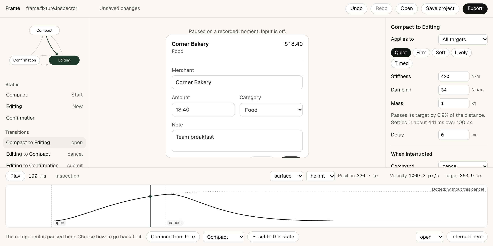

# Frame

A local motion editor for working React components, built around one question: what should happen when someone changes their mind halfway?



Use your real component. Interrupt it. Frame records that as a take, and you can scrub it, drag the interruption to a new moment, and change what happens there. Export a small runtime that behaves the same way in your app.

**[Watch 17 seconds of it working](docs/media/signature.mp4)**, or the [73 second technical walkthrough](docs/media/walkthrough.mp4). The walkthrough has captions and no narration.

| | |
|---|---|
| **Studio and export agree** | Within 0.000015 px and 0 opacity, in 120 scripted runs across Chromium, WebKit and Firefox |
| **What you inspect matches what ships** | The same limits, comparing the replayed take to the export |
| **Those checks can fail** | 9 of 9 seeded faults caught, and clean builds not flagged |
| **Physics** | Real browser geometry within 0.094 px of an independent numerical solution |
| **Editing at 30 targets** | Median 1.5 ms, p95 2.2 ms to update the DOM |
| **Cost to your app** | 6.2 KB of gzipped JavaScript and 0.14 KB of CSS, with no dependency except React |

Measured on one Apple M5 Pro Mac in headless browsers, with other work running. The fidelity check compares two builds of the same code, so it tests everything around the physics, and a separate check tests the physics. No person has run the usability task, and no physical phone was tested. [What the numbers leave out](docs/REPORT.md#what-the-numbers-leave-out) has the details.

## Run it

You need Node 22 and pnpm.

```bash
git clone https://github.com/qbeka/frame-studio.git
```

```bash
cd frame-studio
```

```bash
pnpm install
```

```bash
pnpm dev
```

Open <http://localhost:5172>. Press **Edit expense**, then press **Cancel** before it settles. Press **Pause**, and drag the `cancel` marker.

## Use it on your own component

Your component takes a frame handle. That is the only change to it.

```tsx
export function Receipt({ frame, props, setProps }) {
  return (
    <article {...frame.root()}>
      <div {...frame.target('paper')} className="paper" aria-hidden="true" />
      <button {...frame.target('head')} onClick={() => frame.send('unfold')}>
        {props.vendor}
      </button>
      <ul {...frame.target('lines')}>...</ul>
    </article>
  );
}
```

Add Frame to your project. It is installed from GitHub, as it is not on npm.

```bash
pnpm add -D "github:qbeka/frame-studio#path:packages/studio"
```

Declare its states, targets and commands in a registration. [This one](examples/receipt-app/src/frame.registrations.tsx) is 44 lines, and [the guide](docs/REGISTRATION.md) explains each part. Frame does not read React internals, and it cannot import a component that has not been registered.

```bash
pnpm exec frame dev src/frame.registrations.tsx
```

Author it, press **Export**, and copy the folder into your source tree. Production makes the same handle from those files.

```tsx
import { useFrame } from './motion/runtime';
import { motion } from './motion/motion.config';
import './motion/frame.css';

const frame = useFrame(motion);
```

The export is readable TypeScript. It needs React 18.3 or 19 and a bundler that compiles TypeScript, and it has been tested in clean Vite and Next.js apps. Nothing from Frame has to be running or installed. To remove it, delete the folder and the spreads.

## What it does

- **Takes.** Commands are recorded by name, with the measured layout at each one, and never as screen coordinates. Content you declare as props is recorded too.
- **Interruption rules.** When a command lands mid transition, retarget from the current position and speed, finish first, or ignore it. A rule can have its own spring.
- **The ribbon.** The solid line is what a channel did. The dotted line is what it would have done without the interruption. Drag a marker and both update, along with the component.
- **Real DOM.** Your component stays a working interface throughout, so typed text and focus survive a reversal. Layout endpoints come from native document flow. Text is never scaled.
- **Inspection.** Read position, velocity and target at any moment. Scrubbing gives a defined sample, and you choose whether to continue from there or reset.
- **Files.** Undo, automatic drafts, and a portable project file. A bad file changes nothing and tells you why.

## Limits

- It works on components you register. It cannot import an arbitrary website.
- Motion is limited to translation, scale on text-free elements, opacity, clipping and measured bounds. Anything else is rejected with a reason.
- Elements outside the registered root do not animate.
- A CSS or Web Animations export is not offered. Neither can start a spring from a speed, so it would look close and behave differently. Each export lists this per transition.
- It is a desktop workspace. On a phone you get the preview, the transport and the selected property. Exports work on phones.

## Test it

```bash
pnpm check
```

```bash
pnpm test
```

```bash
pnpm test:e2e
```

`pnpm check` runs the type checker and the writing rules. `pnpm test` runs 118 unit tests, including 50 digit reference values. `pnpm test:e2e` runs 64 browser tests against the studio, clean Vite and Next.js apps, and a full release run, which needs consumers built outside this folder and takes a few minutes.

To run the suites in another engine:

```bash
FRAME_BROWSER=webkit pnpm test:e2e tests/e2e/consumer.spec.ts tests/e2e/fidelity.spec.ts
```

To run all of it from a fresh clone:

```bash
scripts/verify-clean.sh --bench
```

To seed faults into the logic and read why each one was caught:

```bash
node scripts/mutants.mjs
```

## Measure it

```bash
pnpm bench:smoke
```

```bash
pnpm bench
```

The smoke run checks the harness, and its numbers are not results. The full run follows [the protocol](bench/PROTOCOL.md). Raw samples and manifests are in [`results/`](results). The [report](docs/REPORT.md) has every table, what failed, and what changed because of it.

## How it works

```
packages/studio/
  runtime/     The part that ships. No DOM or React in the first five files.
    spring.ts      Closed-form damped springs in all three regimes
    tween.ts       CSS cubic-bezier, with a true derivative
    channel.ts     One value over time, as legs that can be replaced
    timeline.ts    Semantic state, interruption rules and take replay. Pure.
    dom.ts         Measures layout and draws samples. All DOM access is here.
    controller.ts  Clock, commands, focus and resize
    react.ts       useFrame
  authoring/   Registration API, strict parser, migrations, exporter
  editor/      The studio
  cli/         frame dev, init, validate, export
fixtures/      The expense inspector
site/          The project page, with the replay on the shipped runtime
examples/      Clean Vite and Next.js apps, and a tarball consumer
reference/     Independent spring values
bench/         Protocol, harness and baselines
tests/         Unit and browser suites
```

**The time model is the core idea.** Every value is a closed-form function of time. A frame callback only samples it, so the answer at a given moment cannot depend on how often the browser asked. A retarget ends one leg and starts another from the exact position and speed at the moment of the event. A take is a list of timestamped events, so editing a spring reruns the same take through a pure function.

Size changes without distorting text. A `surface` is a text-free layer sized directly, so it keeps a true border and radius. A `clip` reveals content with `clip-path`. See [the design notes](docs/DESIGN.md) for the rejected keyframe approach, and [the research notes](docs/RESEARCH.md) for what was taken from Motion, Theatre.js, Rive and the Web Animations API.

## License

MIT. See [LICENSE](LICENSE) and [ATTRIBUTION.md](ATTRIBUTION.md). Not affiliated with Vercel, Motion, Theatre.js or Rive.
